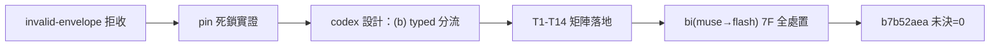

## Description

<!-- SECTION:DESCRIPTION:BEGIN -->
D-011 回信實證（2026-10-14）：send_reply 在 transport 嘗試**前** pin（reply_envelope_id＋reply_sha256＋outbox snapshot）；store 端 schema 拒收（invalid-envelope：缺 message_id）後 pin 保留——同 bytes 重試永遠再被拒、換內容被 pin 擋（mark-read reread 路徑 setdefault 不清 pin），只能手術改狀態檔。本卡修這個 face 缺口：codex 討論設計→judge→實作。

**做什麼**
- codex 討論：修在哪層（pin 前 schema 預檢／invalid-envelope 自動解 pin／mark-read 真清 pin）＋never-valid vs transient 拒收分類＋測試設計
- judge 裁決→實作→驗證

**不做什麼**
- 不改 envelope v2 凍結 schema 本身；不改 transport 層（dutymail store 歸其 repo）

<!-- SECTION:DESCRIPTION:END -->

## Acceptance Criteria
<!-- AC:BEGIN -->
- [x] #1 typed refusal 分流落地：predicate 四條件合取、清 pin 順序（先持久後 snapshot）、crash-window 各態有釘
- [x] #2 T1-T16 矩陣全綠（死鎖核心 T1→T2 無手術；shared 護衛雙向 T15/T16；response-loss T14）
- [x] #3 unsupported-envelope-schema 有真 binary producer 證據（sv=1/3 probe＋e2e 零受理釘死）
- [x] #4 mail-handle SKILL 同步一句＋docstring 混版前提句；F-4 既存事項列 D-012 improvement 台帳
- [x] #5 全量 pytest＋ruff 零新增違規
<!-- AC:END -->

## Implementation Plan

<!-- SECTION:PLAN:BEGIN -->
〔baseline：ai-guide 3bdfbf85〕〔已決策勿重辯：①採 codex 討論案——(b) transport typed refusal 分流（predicate：DutymailFaceError＋class=usage＋code∈{invalid-envelope,unsupported-envelope-schema}＋retryable=False→pending lock 內清 pin→save（OSError 保留 fail-loud）→刪 snapshot（揭露 orphan）→fail-loud；其他失敗保留 pin 冪等重試）；(a) schema 預檢否決（drift）、(c) mark-read 自動解 pin 否決（破 response-loss 去重）②混版前提（單機部署可接受）記 docstring③測試矩陣 T1-T14＋flash 外審補測 T15/T16④mail-handle SKILL 一句同步〕範圍：duty_receive.py＋tests 兩檔＋mail-handle SKILL.md；驗收＝T1-T16 全綠＋全量＋ruff 零新增＋死鎖場景 T1→T2 無 state 手術。
<!-- SECTION:PLAN:END -->

## Implementation Notes

<!-- SECTION:NOTES:BEGIN -->
post-build 收斂落卡（AIR-121）：review_ledger converged parse＝findings 7／✅ 7／verified 6＋closed 1／未決 0。panel＝bi(muse→flash)——muse failed-usage 額度缺額由 in-harness flash code-reviewer 替補（工單註明）。三腿處置：codex C-1＝base-drift 假象（分支 ff 吸收 main 消除，AIR-337 卡 alive）、C-2＝真 binary probe 補證（sv=1/3→unsupported-envelope-schema usage/retryable-false/exit2、store 零受理、e2e 釘死）；flash M-1＝T15/T16 shared 護衛雙向補測、M-2＝docstring 混版前提句、M-3＝記 candidate 不阻塞、M-4＝D-012 improvement 台帳（nonblocking）、M-5＝情報無動作。scoped 47／e2e 3／全量 3998 passed；ruff 零新增。watcher-ack 調查否證記錄見前則 notes。
<!-- SECTION:NOTES:END -->

## Final Summary

<!-- SECTION:FINAL_SUMMARY:BEGIN -->
invalid-envelope pin 死鎖收線：send_reply 對確定性 schema 拒收（invalid-envelope／unsupported-envelope-schema，usage/retryable-false）自動解 pin 保留 pending 義務——修正 draft 後重新授權即可寄送，全程無需 state 手術；其他失敗維持原 ID＋bytes 冪等重試（response-loss 去重不變）。typed predicate 三條件合取經 producer error contract＋真 binary probe（sv=1/3）背書；T1-T16 矩陣含 crash-window/shared 護衛/response-loss 全釘。三腿審查（codex 2F＋flash 5F）全處置、帳本未決=0。

<!-- SECTION:FINAL_SUMMARY:END -->
