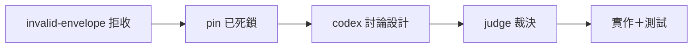

## Description

<!-- SECTION:DESCRIPTION:BEGIN -->
D-011 回信實證（2026-10-14）：send_reply 在 transport 嘗試**前** pin（reply_envelope_id＋reply_sha256＋outbox snapshot）；store 端 schema 拒收（invalid-envelope：缺 message_id）後 pin 保留——同 bytes 重試永遠再被拒、換內容被 pin 擋（mark-read reread 路徑 setdefault 不清 pin），只能手術改狀態檔。本卡修這個 face 缺口：codex 討論設計→judge→實作。

**做什麼**
- codex 討論：修在哪層（pin 前 schema 預檢／invalid-envelope 自動解 pin／mark-read 真清 pin）＋never-valid vs transient 拒收分類＋測試設計
- judge 裁決→實作→驗證

**不做什麼**
- 不改 envelope v2 凍結 schema 本身；不改 transport 層（dutymail store 歸其 repo）

<!-- SECTION:DESCRIPTION:END -->
