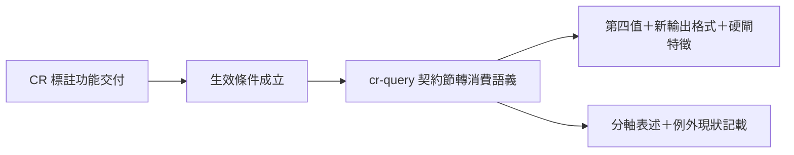

## Description

<!-- SECTION:DESCRIPTION:BEGIN -->
code-reality 端的圖 freshness 標註功能（0.14.0，已上 PyPI）交付上線——我方 cr-query 技巧檔裡先前「只宣告未生效」的三層標註契約，生效條件現在成立，本卡把它轉成正式消費規則。

**做什麼**
- 補第四種標註值（delta 無法回答時的降級態）的消費規則
- 讓 AI 消費端認得新輸出格式：查詢結果第二行的標註列、負向查詢被硬閘擋下時的字面特徵、查詢工具 21→22
- 表述紀律：「圖能不能用」（fresh/stale）與「答案品質」（tier）是兩條軸——措辭分軸寫，禁混寫（bridge 端審查轉來的警示）
- 記載現狀：負向查詢的精確例外所需供給（符號級 outbound 清單）對方尚未實作，例外暫不生效、硬閘照舊；日後對方供給時走版本化討論

**不做什麼**
- 不動 fresh 圖的既有消費規則；不動審查帳本的凍結格式

**證據指針**
- 凍結契約＝code-reality repo `ai-analysis/execution-plans/_done/2026-10-14-cr-delta-freshness/contract-fixture-v1.md`（§1 詞彙表＋§5 對照表）
- 對齊信往返：`aiguide-air330-vocab-reply-20261014` ↔ `cr-air330-granularity-reply-040716`
- 轉交警示出處＝bridge DB-125 回執

<!-- SECTION:DESCRIPTION:END -->
