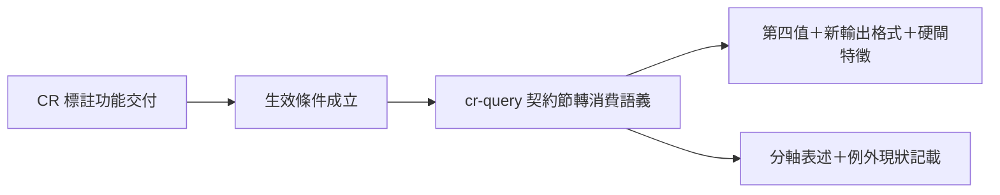
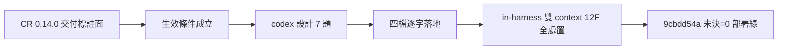

## Description

<!-- SECTION:DESCRIPTION:BEGIN -->
code-reality 端的圖 freshness 標註功能（0.14.0，已上 PyPI）交付上線——我方 cr-query 技巧檔裡先前「只宣告未生效」的三層標註契約，生效條件現在成立，本卡把它轉成正式消費規則。

**做什麼**
- 補第四種標註值（delta 無法回答時的降級態）的消費規則
- 讓 AI 消費端認得新輸出格式：查詢結果第二行的標註列、負向查詢被硬閘擋下時的字面特徵、查詢工具 21→22
- 表述紀律：「圖能不能用」（fresh/stale）與「答案品質」（tier）是兩條軸——措辭分軸寫，禁混寫（bridge 端審查轉來的警示）
- 記載現狀：負向查詢的精確例外所需供給（符號級 outbound 清單）對方尚未實作，例外暫不生效、硬閘照舊；日後對方供給時走版本化討論

**不做什麼**
- 不動 fresh 圖的既有消費規則；不動審查帳本的凍結格式

**證據指針**
- 凍結契約＝code-reality repo `ai-analysis/execution-plans/_done/2026-10-14-cr-delta-freshness/contract-fixture-v1.md`（§1 詞彙表＋§5 對照表）
- 對齊信往返：`aiguide-air330-vocab-reply-20261014` ↔ `cr-air330-granularity-reply-040716`
- 轉交警示出處＝bridge DB-125 回執

<!-- SECTION:DESCRIPTION:END -->

## Acceptance Criteria
<!-- AC:BEGIN -->
- [x] #1 契約節轉消費語義：兩軸分治＋四值 tier（含 indeterminate）＋negative 硬閘（null≠允許、無標註 op 不支撐）＋delta 邊界＋per-face provenance＋例外現狀（四條件 K2）
- [x] #2 生效 gate 改 query-time schema 偵測＋舊版二元後備（不綁產品版號；損壞標註 fail-closed 不落後備）
- [x] #3 跨 consumer 三檔同步句落地（symbol-query-routing／review-engine [cr:present] per-query 準入／work-order overlap 機械定義＋後備括注）
- [x] #4 in-harness 雙 context 12 findings 全處置（帳本 converged 未決=0）
- [x] #5 四端部署＋部署新鮮度 critical=0（deploy_bundle_freshness）
<!-- AC:END -->

## Implementation Plan

<!-- SECTION:PLAN:BEGIN -->
〔baseline：ai-guide 895a9f6d〕〔已決策勿重辯：①採 codex 設計全案——契約節轉消費語義（兩軸分治／四值 tier 含 indeterminate／negative 硬閘 null≠允許、無標註 op 不支撐 negative/exhaustive／delta_paths display-only 權威在 freshness --json／per-face provenance 不要求跨 face 字串相等／stale negative 例外維持不生效＋四條件 K2 啟動）②生效 gate 改 query-time schema 偵測＋舊版二元後備（不綁產品版號）③跨 consumer 必要同步三檔（symbol-query-routing:12／review-engine:184,211／work-order:83,93）；暫不同步六檔（spec §七）④審查降級 in-harness 雙 context（外家族窗口不可達顯式記錄）〕範圍：cr-query SKILL＋symbol-query-routing＋review-engine＋work-order 四檔；驗收＝雙 context findings 全處置＋帳本未決=0＋部署新鮮度 critical=0。
<!-- SECTION:PLAN:END -->

## Implementation Notes

<!-- SECTION:NOTES:BEGIN -->
post-build 收斂落卡（AIR-121）：review_ledger converged parse＝findings 12／✅ 12／verified 11＋closed 1／未決 0。審查＝in-harness 雙 context（fresh agent_a2e802e8 approve 7F＋primed agent_6291cfc6 approve 5F）——外家族降級顯式記錄：muse workspace-mismatch 確定性×2＋codex failed-or-capped infra×2（此窗口皆不可達）。八處修復全錨點驗證＋全量 3998 passed。FR-6（lsp-harvest golden-only 禁令入枚舉）留後續卡。AIR-330 face-啟用增補完成：契約節轉消費語義＋跨 consumer 三檔同步＋分軸表述。
<!-- SECTION:NOTES:END -->

## Final Summary

<!-- SECTION:FINAL_SUMMARY:BEGIN -->
AIR-330 face-啟用增補收線：cr-query「契約宣告」節轉正式消費語義（兩軸分治——freshness 可用性／tier 品質；四值 tier 含 indeterminate；negative verdict 硬閘 null≠允許、無標註 op 不支撐 negative/exhaustive；delta_paths display-only 權威在 freshness --json；per-face provenance 綁定；stale negative 例外維持不生效、四條件 K2 啟動）。生效 gate 改 query-time schema 偵測＋舊版二元後備。跨 consumer 三檔同步（symbol-query-routing／review-engine [cr:present] per-query 準入／work-order overlap 機械定義）。in-harness 雙 context 審查 12 findings 全處置、帳本未決=0；四端部署 25,856B＋部署新鮮度 critical=0。

<!-- SECTION:FINAL_SUMMARY:END -->
